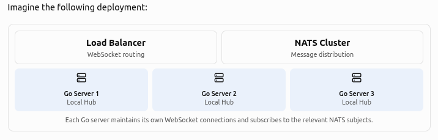
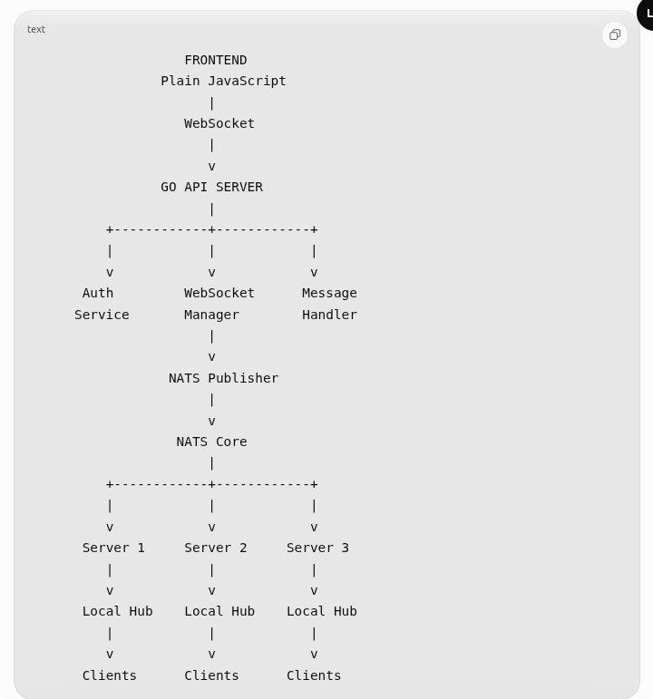

# Building a WebSocket application with plain JavaScript, Golang, and NATS

Let's approach this as a production-grade backend system.

We'll build an application where:

- `Frontend`: Plain JavaScript connects to the backend using WebSockets.

- `Backend`: Golang manages WebSocket connections and messages.

- `Message broker`: NATS distributes messages between backend instances.

- `Communication`: A message sent by one browser can be delivered to other connected browsers, even when they are connected to different Go server instances.

The important architectural decision is that WebSocket handles client communication, while NATS handles `backend-to-backend communication`.

## 1. Understand the architecture

Imagine two users connected to two different Go servers.


The message flow:

1. Browser A sends a message through WebSocket.

2. Go Server 1 receives the message.

3. Go Server 1 publishes the message to a NATS subject.

4. Go Server 2 receives that NATS message through its subscription.

5. Go Server 2 sends the message to Browser B through WebSocket.

This architecture allows you to horizontally scale your Go backend without requiring browsers to connect to the same server.

## 2. Understand the responsibilities

| Component      | Responsibility                                    |
| -------------- | ------------------------------------------------- |
| JavaScript     | Establish connection, send and receive messages   |
| WebSocket      | Persistent, bidirectional client connection       |
| Go             | Authentication, validation, connection management |
| NATS Core      | Real-time message distribution                    |
| NATS JetStream | Persistent messaging when needed                  |

_Important distinction_: NATS Core Pub/Sub is not a message queue with guaranteed delivery. If a subscriber is disconnected, it misses messages. JetStream is useful when persistence, replay, or acknowledgment is required.

## 3. Project structure

Let's create a small but extensible project:

```text
realtime-app/
├── backend/
│ ├── main.go
│ ├── hub.go
│ ├── client.go
│ └── go.mod
├── frontend/
│ ├── index.html
│ └── app.js
└── docker-compose.yml
```

We'll use:

- github.com/gorilla/websocket for WebSocket connections.

- github.com/nats-io/nats.go for NATS communication.

- Go's standard net/http package for the HTTP server.

Install dependencies:

```bash
cd backend

go mod init realtime-app

go get github.com/gorilla/websocket
go get github.com/nats-io/nats.go
```

Start NATS locally:

```bash
docker run --rm -p 4222:4222 nats:latest
```

NATS uses port 4222 for client connections.

## 4. Define the message structure

Before implementing the connection, define a consistent message format.

For example:

```json
{
  "type": "chat",
  "room": "general",
  "userId": "user-123",
  "message": "Hello everyone!",
  "timestamp": "2026-11-12T14:30:00Z"
}
```

I recommend using a common message structure for all communication.

In Go:

```go
package main

import "time"

type Message struct {
Type string `json:"type"`
Room string `json:"room"`
UserID string `json:"userId"`
Message string `json:"message"`
Timestamp time.Time `json:"timestamp"`
}
```

Later, you can extend this with:

- messageId

- correlationId

- metadata

- recipientId

- eventType

This becomes especially useful when your application grows beyond chat functionality.

## 5. Implement the WebSocket connection manager

A connection manager, commonly called a Hub, maintains all WebSocket clients connected to the current Go server.

Each client has:

- A WebSocket connection.

- A buffered outgoing message channel.

- A unique identifier.

hub.go:

```go
package main

import "sync"

type Hub struct {
	clients map[*Client]bool
	mu      sync.RWMutex
}

func NewHub() *Hub {
	return &Hub{
		clients: make(map[*Client]bool),
	}
}

func (h *Hub) Register(c *Client) {
	h.mu.Lock()
	defer h.mu.Unlock()

	h.clients[c] = true
}

func (h *Hub) Unregister(c *Client) {
	h.mu.Lock()
	defer h.mu.Unlock()

	if _, ok := h.clients[c]; ok {
		delete(h.clients, c)
		close(c.send)
	}
}

func (h *Hub) Broadcast(message []byte) {
	h.mu.RLock()
	defer h.mu.RUnlock()

	for client := range h.clients {
		select {
		case client.send <- message:
		default:
			// Slow client: skip delivery.
			// Production implementation should
			// disconnect the slow client safely.
		}
	}
}

```

### Why use a channel for each client?

We don't want the NATS subscriber to write directly to every WebSocket connection.

Instead:

- NATS receives a message.

- Hub distributes the message to client channels.

- Each client's dedicated writer goroutine sends messages over its WebSocket.

This separates message processing from network I/O.

## 6. Implement the WebSocket client

client.go:

```go
package main

import (
	"log"
	"time"

	"github.com/gorilla/websocket"
)

type Client struct {
	conn *websocket.Conn
	send chan []byte
	hub  *Hub
}

const (
	writeWait      = 10 * time.Second
	pongWait       = 60 * time.Second
	pingPeriod     = 54 * time.Second
	maxMessageSize = 4096
)

func (c *Client) ReadPump(natsPublisher func([]byte) error) {
	defer func() {
		c.hub.Unregister(c)
		c.conn.Close()
	}()

	c.conn.SetReadLimit(maxMessageSize)
	c.conn.SetReadDeadline(time.Now().Add(pongWait))

	c.conn.SetPongHandler(func(string) error {
		c.conn.SetReadDeadline(time.Now().Add(pongWait))
		return nil
	})

	for {
		_, message, err := c.conn.ReadMessage()
		if err != nil {
			break
		}

		if err := natsPublisher(message); err != nil {
			log.Printf("NATS publish error: %v", err)
		}
	}
}

func (c *Client) WritePump() {
	ticker := time.NewTicker(pingPeriod)
	defer func() {
		ticker.Stop()
		c.conn.Close()
	}()

	for {
		select {
		case message, ok := <-c.send:
			c.conn.SetWriteDeadline(time.Now().Add(writeWait))

			if !ok {
				c.conn.WriteMessage(
					websocket.CloseMessage,
					[]byte{},
				)
				return
			}

			if err := c.conn.WriteMessage(
				websocket.TextMessage,
				message,
			); err != nil {
				return
			}

		case <-ticker.C:
			c.conn.SetWriteDeadline(time.Now().Add(writeWait))

			if err := c.conn.WriteMessage(
				websocket.PingMessage,
				nil,
			); err != nil {
				return
			}
		}
	}
}

```

### Senior Go engineering concept:

We use two goroutines per WebSocket connection:

- `ReadPump`: reads messages from the browser.

- `WritePump`: writes messages to the browser.

This is important because Gorilla WebSocket supports one concurrent reader and one concurrent writer per connection. Having dedicated pumps makes that ownership clear.

## 7. Connect Go with NATS

Now comes the interesting part.

Each Go server establishes a connection to NATS and subscribes to a subject.

For this example, we'll use:

```text
chat.room.general
```

When a browser sends a message, the Go server publishes it to this subject.

Every Go server subscribed to this subject receives the message.

main.go:

```go
package main

import (
	"log"
	"net/http"

	"github.com/gorilla/websocket"
	"github.com/nats-io/nats.go"
)

var allowedOrigins = map[string]bool{
	"http://localhost:8080": true,
	"http://127.0.0.1:8080": true,
	"http://127.0.0.1:5500": true,
	"http://localhost:5500": true,
}
var upgrader = websocket.Upgrader{
	ReadBufferSize:  1024,
	WriteBufferSize: 1024,

	// CheckOrigin: func(r *http.Request) bool {
	// 	return r.Header.Get("Origin") == "http://localhost:8080"
	// },

	CheckOrigin: func(r *http.Request) bool {
		origin := r.Header.Get("Origin")
		return allowedOrigins[origin]
	},
}

func main() {
	// Connect to NATS.
	nc, err := nats.Connect(
		nats.DefaultURL,
		nats.Name("realtime-server"),
	)
	if err != nil {
		log.Fatal(err)
	}
	defer nc.Close()

	hub := NewHub()

	// Subscribe to messages.
	_, err = nc.Subscribe("chat.room.general", func(msg *nats.Msg) {
		hub.Broadcast(msg.Data)
	})
	if err != nil {
		log.Fatal(err)
	}

	if err := nc.Flush(); err != nil {
		log.Fatal(err)
	}

	http.HandleFunc("/ws", func(w http.ResponseWriter, r *http.Request) {

		log.Printf("Origin: %s", r.Header.Get("Origin"))
		log.Printf("Host: %s", r.Host)
		conn, err := upgrader.Upgrade(w, r, nil)
		if err != nil {
			log.Println("WebSocket upgrade error:", err)
			return
		}

		client := &Client{
			conn: conn,
			send: make(chan []byte, 256),
			hub:  hub,
		}

		hub.Register(client)

		go client.WritePump()

		client.ReadPump(func(message []byte) error {
			return nc.Publish("chat.room.general", message)
		})
	})

	log.Println("WebSocket server listening on :8080")

	log.Fatal(http.ListenAndServe(":8080", nil))
}

```

Let's understand what happens here.

### When the application starts:

- Go connects to NATS.

- Go subscribes to chat.room.general.

- Go starts the HTTP server.

### When a browser connects:

- The HTTP request upgrades to WebSocket.

- A new client is registered in the Hub.

- Two goroutines handle reading and writing.

### When a browser sends a message:

- ReadPump reads the message.

- The message is published to NATS.

- The NATS subscription receives it.

- hub.Broadcast() distributes it to local WebSocket clients.

This is the complete message pipeline.

## 8. Implement the frontend using plain JavaScript

No React, Vue, Angular, or other frontend framework is needed.

index.html:

```html
<!DOCTYPE html>
<html lang="en">
  <head>
    <meta charset="UTF-8" />
    <title>Go WebSocket + NATS</title>
  </head>
  <body>
    <h2>Realtime Chat</h2>

    <div id="status">Connecting...</div>

    <div id="messages"></div>

    <input id="messageInput" type="text" placeholder="Enter message..." />

    <button id="sendButton">Send</button>

    <script src="app.js"></script>
  </body>
</html>
```

app.js:

```javascript
const socket = new WebSocket("ws://localhost:8080/ws");

const status = document.getElementById("status");
const messages = document.getElementById("messages");
const input = document.getElementById("messageInput");
const sendButton = document.getElementById("sendButton");

socket.onopen = () => {
  status.textContent = "Connected";
  console.log("WebSocket connected");
};

socket.onmessage = (event) => {
  const data = JSON.parse(event.data);

  const div = document.createElement("div");

  div.textContent = `${data.userId}: ${data.message}`;

  messages.appendChild(div);
};

socket.onerror = (error) => {
  console.error("WebSocket error:", error);
};

socket.onclose = () => {
  status.textContent = "Disconnected";
};

sendButton.addEventListener("click", sendMessage);

function sendMessage() {
  if (socket.readyState !== WebSocket.OPEN) {
    console.error("WebSocket is not connected");
    return;
  }

  const message = {
    type: "chat",
    room: "general",
    userId: "user-123",
    message: input.value,
    timestamp: new Date().toISOString(),
  };

  socket.send(JSON.stringify(message));

  input.value = "";
}
```

Notice that the frontend doesn't know anything about NATS.

It only communicates with the Go backend.

This is exactly what we want: the frontend should not need to understand your internal messaging infrastructure.

## 9. Run the application

Start NATS:

```bash
docker run --rm \
 --name nats \
 -p 4222:4222 \
 nats:latest
```

Start the Go backend:

```bash
cd backend

go run .
```

Serve the frontend:

```bash
cd frontend

python3 -m http.server 8080
```

There is a port conflict in this initial example because both services use port 8080. For a working setup, change the Go HTTP server to port 8081 and the frontend WebSocket URL to:

```javascript
const socket = new WebSocket("ws://localhost:8081/ws");
```

Then open:

```text
http://localhost:8080
```

Open the same page in two browser tabs.

Send a message from one tab. You should see it appear in both tabs.

## 10. What happens when you scale to multiple Go servers?

    This is where NATS becomes particularly useful.

Imagine the following deployment:



Suppose:

- User A connects to Go Server 1.

- User B connects to Go Server 2.

- User C connects to Go Server 3.

- User A sends a message.

NATS distributes that message to all three Go servers subscribed to the subject.

Each server broadcasts the message to its own connected clients.

Result:

- User A receives the message.

- User B receives the message.

- User C receives the message.

You don't need to maintain a global WebSocket connection registry across all Go servers.

That's one of the biggest advantages of this architecture.

## 11. Important production improvements

    The example above demonstrates the architecture, but I wouldn't deploy it as-is.

Here are the improvements I'd make before production.

| Area               | Production implementation                           |
| ------------------ | --------------------------------------------------- |
| Authentication     | JWT validation during WebSocket handshake           |
| Authorization      | Verify room membership before publishing            |
| Origin validation  | Explicit frontend origin allowlist                  |
| Message validation | Validate JSON, type, size and fields                |
| Backpressure       | Disconnect slow consumers                           |
| Reconnection       | Automatic client reconnect with exponential backoff |
| NATS               | Connection monitoring and reconnect handling        |
| Security           | WSS, TLS, NATS credentials                          |
| Observability      | Structured logs, Prometheus metrics, tracing        |
| Scaling            | Multiple Go instances behind a load balancer        |

### A. Use room-based NATS subjects

Instead of hardcoding:

```go
nc.Publish("chat.room.general", message)
```

Use:

```go
subject := "chat.room." + roomID

nc.Publish(subject, message)
```

And subscribe using a wildcard:

```go
nc.Subscribe("chat.room.*", func(msg *nats.Msg) {
// Route the message to the appropriate local room.
})
```

However, this requires changing the Hub to maintain room membership:

```go
type Hub struct {
rooms map[string]map[*Client]bool
mu sync.RWMutex
}
```

This is important because you don't want a message for room general reaching clients in room private.

Also validate roomID against an allowed format before using it in a NATS subject.

### B. Don't let clients publish arbitrary NATS subjects

A browser should never be able to decide which NATS subject gets published.

The correct flow is:

```text
Browser
|
| JSON message
v
Go WebSocket Handler
|
| Authenticate user
| Validate room membership
| Validate message
v
NATS Publisher
|
v
NATS Subject
```

Your Go backend owns subject selection and authorization.

### C. Understand Core NATS versus JetStream

This distinction is important for system design.

| Requirement                    | Recommended technology |
| ------------------------------ | ---------------------- |
| Live chat messages             | Core NATS              |
| Live notifications             | Core NATS              |
| Typing indicators              | Core NATS              |
| Presence updates               | Core NATS              |
| Persistent event history       | JetStream              |
| Replay missed events           | JetStream              |
| Reliable background processing | JetStream              |

Core NATS is at-most-once. JetStream adds persistence and acknowledgment-based delivery, including at-least-once delivery.

NATS Documentation
+1

One important architectural point: even if you use JetStream, WebSocket delivery itself is not automatically guaranteed. You need client acknowledgments, message IDs, replay cursors, and deduplication if you require reliable end-to-end delivery.

## 12. A few senior-level architectural decisions

    There are three design decisions I'd pay particular attention to.

### 1. Should every Go server subscribe to every room?

Not necessarily.

For a small application, one wildcard subscription per Go server is perfectly reasonable.

For a large application with thousands of rooms, consider:

- Dynamically subscribing when the first local client joins a room.

- Unsubscribing when the last local client leaves.

- Maintaining room-to-client mappings.

- Using subscription reference counting to avoid duplicate subscriptions.

### 2. Should you use NATS Core or JetStream?

For real-time chat, I'd start with Core NATS and persist chat history in PostgreSQL.

For applications where missed events are unacceptable, introduce JetStream and an acknowledgment/replay mechanism.

### 3. Should you use a separate NATS connection per WebSocket client?

No.

Use one shared NATS connection per Go server instance, not one connection per browser.

The Go server owns the NATS connection and multiplexes messages through its local Hub.

## 13. Recommended final architecture

    For a real production application, I'd organize responsibilities like this:



Useful official documentation:

- NATS architecture and concepts

- NATS Go getting started

- Core NATS deep dive

- NATS Go client

- NATS JetStream

## 14. What I'd recommend building next

    I'd take this example one step further and build a proper reusable real-time messaging service.

The next iteration should include:

- Multiple rooms.

- Private messaging between users.

- Online/offline presence.

- JWT authentication.

- NATS wildcard subscriptions.

- Multiple Go server instances.

- Automatic WebSocket reconnection.

- Graceful shutdown and connection cleanup.

### One important question before designing the next iteration:

What is your primary use case?

- Real-time chat application.

- Live notifications.

- Real-time dashboard / event streaming.

- Collaborative application (multiple users updating the same data).

- Generic WebSocket infrastructure for multiple applications.

The architecture is similar, but the NATS subject design, message delivery guarantees, and connection management will differ significantly.
